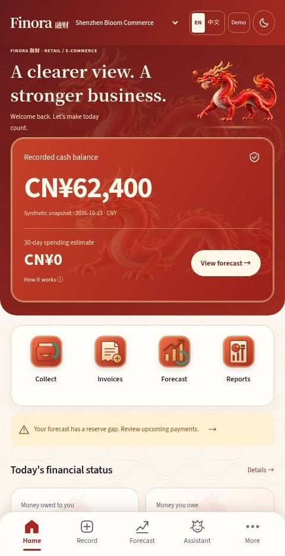
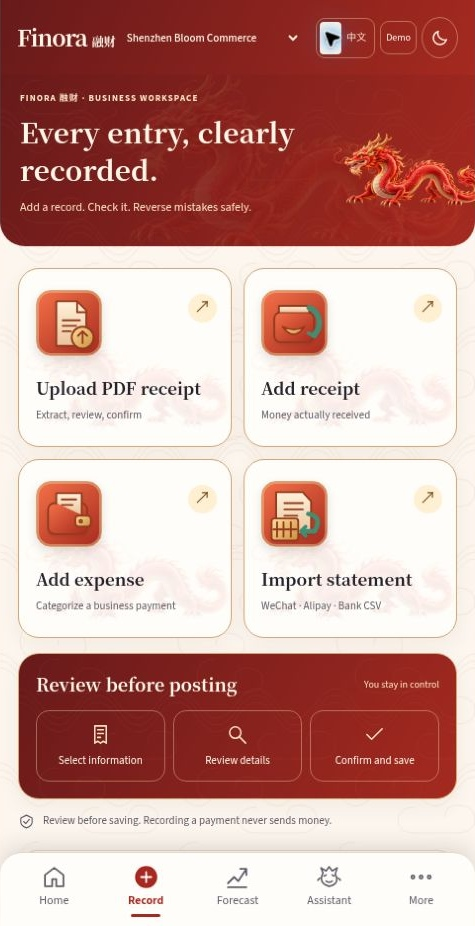
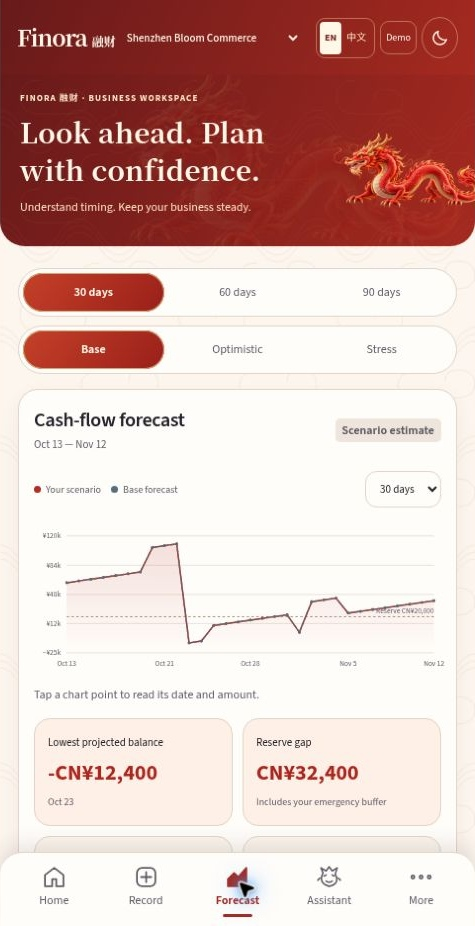
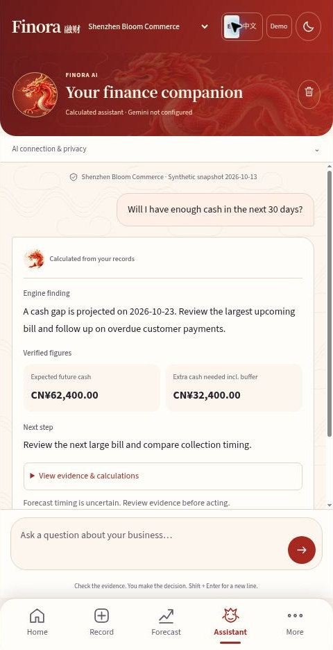
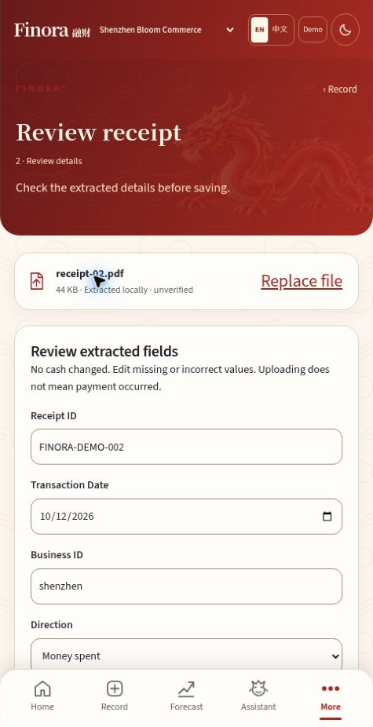
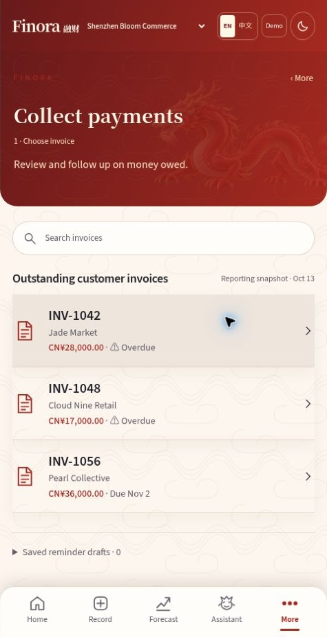
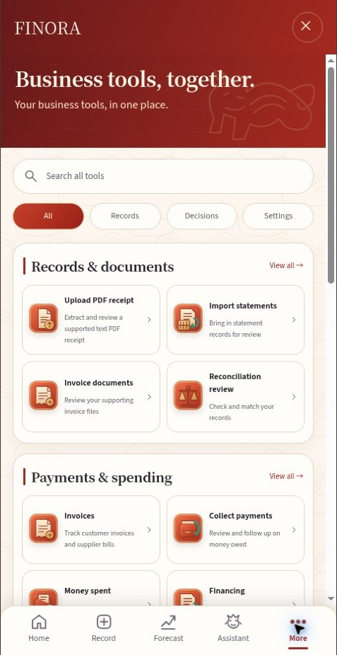
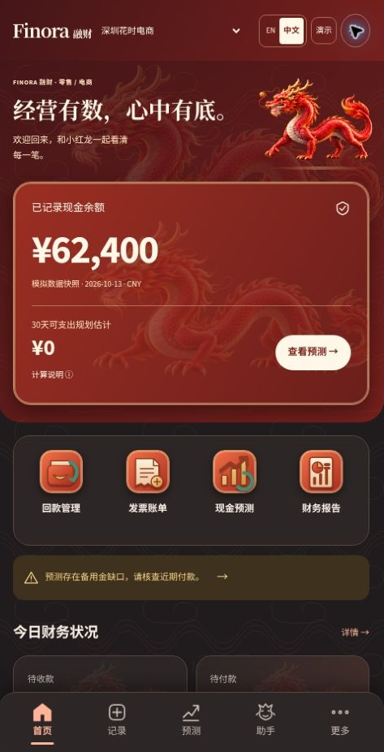
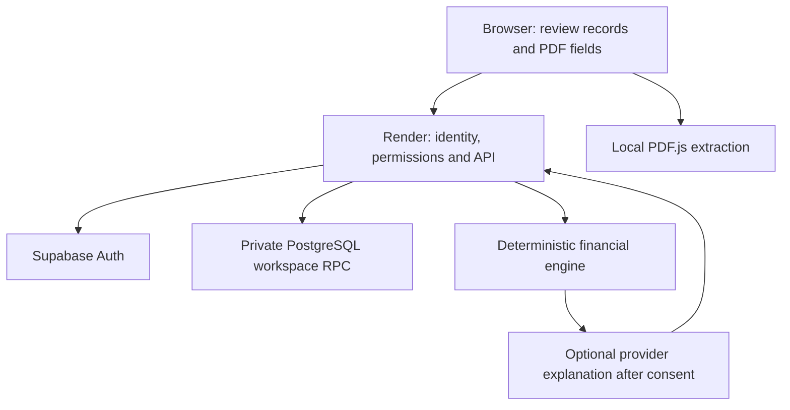

<p align="center"></p>
<h1 align="center">Finora · 融财</h1>
<p align="center"><strong>Your SME finance copilot.</strong><br>Understand your cash. Explore your options. Decide with confidence.</p>
<p align="center">


</p>
<p align="center"><a href="https://finora-sme-copilot.onrender.com/#overview"><strong>Live site ↗</strong></a> · <a href="https://youtu.be/qxC15TDapaI"><strong>Watch demo video ▶</strong></a> · <a href="https://github.com/Sachin133885/finora-sme-copilot">GitHub repository</a> · <a href="#quick-start">Quick start</a> · <a href="docs/USER_GUIDE.md">User guide</a> · <a href="docs/SCREENSHOTS.md">Screenshot guide</a> · <a href="docs/ARCHITECTURE.md">Architecture</a> · <a href="#team">Team</a></p>

**Finora helps small business owners record payments, anticipate cash pressure and compare possible responses before making a decision.** It combines a deterministic financial engine, reviewed document entry and an optional AI explanation layer in an English/Simplified Chinese interface.

Built by **The Fantastic Five**, Daffodil International University, for the **2026 Shenzhen International FinTech Competition (FinTechathon), International Track — Topic E: SME Finance Copilot**. The published competition theme is **“AI as a Financial Participant.”** This describes the project’s intended entry, not organizer endorsement or a finalist/award claim. [Competition and sources](docs/COMPETITION.md).

> **Source versus deployment:** this repository package contains the final **1.2 Vermilion & Ivory** source. The live URL is the existing Render application; deployment of this exact source must be confirmed after upload. The dragon above is **brand artwork**. The [gallery below](#screenshots) contains genuine captures of the updated live preview. Sample records use the fixed **13 October 2026** snapshot, not a verified bank balance.

[Problem](#the-problem) · [Features](#features) · [Screenshots](#screenshots) · [Workflow](#how-to-use-finora) · [Stack](#technology-and-architecture) · [Setup](#quick-start) · [Configuration](#configuration) · [Tests](#testing-and-validation) · [Deployment](#deployment) · [Limits](#limitations-and-roadmap)

## Live site and demo

- **Live application:** [Open Finora](https://finora-sme-copilot.onrender.com/#overview)
- **Demo video:** [Watch the Finora walkthrough on YouTube](https://youtu.be/qxC15TDapaI)
- **Source code:** [Sachin133885/finora-sme-copilot](https://github.com/Sachin133885/finora-sme-copilot)

## The problem

An SME owner can have cash today and still struggle to pay a supplier next week. Customer payments arrive late, obligations sit in separate records and a proposed loan may solve one deadline while adding another cost. A balance alone does not explain what happens next.

Finora brings recorded money, customer invoices, supplier bills and forecast assumptions into a shared review workflow. Owners can see the lowest expected balance, preserve an emergency buffer, stress a customer delay and compare collections, supplier timing and hypothetical financing.

**A typical story:** a Shenzhen shop owner reviews an unpaid customer invoice and an upcoming supplier bill. They upload a supported receipt, correct the extracted fields and confirm that payment occurred before posting. Next, they test a seven-day customer delay in Forecast, compare a supplier deferral in Cash Rescue Planner and save a Decision Receipt explaining the assumptions. None of these planning steps sends a payment, secures a loan or contacts the supplier.

## Features

| Feature | What it does | User benefit |
| --- | --- | --- |
| Recorded cash and safe-to-spend | Separates recorded cash, projected lows and the owner’s emergency buffer | Understand additional spending room and its assumptions |
| Record money | Reviews income/expense entries, history and permitted correction/reversal actions | Keep an understandable ledger |
| PDF receipts | Extracts supported text PDFs locally with editable fields, evidence and explicit paid/posting confirmation | Reduce retyping while retaining control |
| Invoice settlement | Links confirmed payments to existing invoice/bill settlement logic | Update outstanding balances without recording cash twice |
| Statements and reconciliation | Parses supported WeChat/Alipay/bank CSV structures, reviews exceptions and matches records | Find mismatches before committing |
| Collections | Prioritizes overdue invoices and prepares reminder drafts | Plan follow-up without automatically sending messages |
| Forecast | Models supported 30/60/90-day scenarios with payment timing and cost assumptions | Explore future pressure without changing actual payments |
| Cash Rescue Planner | Evaluates a bounded grid of collection, supplier-delay and hypothetical funding options | Compare feasible responses with visible tradeoffs |
| Decision Receipts | Saves planning evidence, assumptions and the selected comparison | Revisit why a decision was considered |
| Reports, confidence and risk | Shows supporting records, missing information and financial warning indicators | Inspect evidence rather than accept an unexplained score |
| Account and cloud workspaces | Supabase-backed owner/accountant/viewer permissions, business isolation and revision checks | Collaborate within permitted workspaces |
| Optional AI copilot | Selects read-only financial tools and explains calculated evidence after separate consent | Ask business questions without delegating financial actions |
| Bilingual interface and guidance | English/Simplified Chinese, welcome, chaptered spotlight guide and responsive navigation | Learn the app at your own pace |
| Vermilion & Ivory design | Red/orange identity, local fonts, light/dark preference and reduced-motion dragon artwork | Maintain a consistent readable interface |

**Important boundaries:** receipt extraction is not official fapiao verification. CSV support is file import, not a live WeChat/Alipay/bank integration. Financing is hypothetical comparison, not a lender approval or application. The latest source defaults to **light**, with an explicitly saved dark preference; it does not automatically follow the OS theme.

## Screenshots

Real interface captures from the [updated dragon preview](https://finora-dragon-preview.dncorleone1211.chatgpt.site/#overview), captured on **19 October 2026**. They show the synthetic Shenzhen business and its **13 October 2026** reporting snapshot.

<table>
<tr>
<td width="50%" align="center">
<strong>Home</strong><br>
<br>
<sub>Recorded cash and the spending estimate, shown in English.</sub>
</td>
<td width="50%" align="center">
<strong>Record</strong><br>
<br>
<sub>PDF receipts, income, expenses and statement imports.</sub>
</td>
</tr>
<tr>
<td width="50%" align="center">
<strong>Forecast</strong><br>
<br>
<sub>Projected cash, the low point and reserve gap.</sub>
</td>
<td width="50%" align="center">
<strong>Assistant</strong><br>
<br>
<sub>A labelled calculated answer with supporting figures.</sub>
</td>
</tr>
</table>

### More app screens

<table>
<tr>
<td width="50%" align="center">
<strong>Receipt review</strong><br>
<br>
<sub>Editable fields extracted from a synthetic text PDF, before posting.</sub>
</td>
<td width="50%" align="center">
<strong>Collections</strong><br>
<br>
<sub>Outstanding invoices and expected customer payments.</sub>
</td>
</tr>
<tr>
<td width="50%" align="center">
<strong>More tools</strong><br>
<br>
<sub>A searchable, categorized directory of business tools.</sub>
</td>
<td width="50%" align="center">
<strong>Chinese dark mode</strong><br>
<br>
<sub>The same synthetic business in Simplified Chinese and dark appearance.</sub>
</td>
</tr>
</table>


These are cropped browser captures of the app’s centered mobile-style workspace, not physical-device tests. The Assistant capture shows calculated fallback mode with Gemini unconfigured. Screenshots do not verify production authentication, cloud synchronization or live AI. [Capture details and provenance](docs/SCREENSHOTS.md).

## How to use Finora

1. **Open Home.** Choose the intended business and language. Check recorded cash, the snapshot date, upcoming obligations and the emergency buffer explanation.
2. **Use Record.** Choose money received, money spent, PDF receipt or statement import. Review extracted/imported values and confirm the intended posting; uploading a document alone does not establish payment.
3. **Check invoices and reconciliation.** Open the relevant tool in More. Settle existing invoices through their settlement workflow and inspect unmatched statement items.
4. **Open Forecast.** Choose a horizon, inspect the lowest point and test payment delays or costs. Scenario changes affect projections, not the recorded ledger.
5. **Compare a response.** Use Cash Rescue Planner or Compare your options. Review assumptions, constraints and stressed results, then optionally save a Decision Receipt.
6. **Ask Assistant.** Inspect calculated evidence. Live provider calls require server configuration, authentication and explicit consent; calculation-based responses are separately labeled.
7. **Use Account and Settings & data.** Check your role and synchronization state. Export a backup before deliberate migration/import, and review the target business before saving.

### Navigation map

| Main tab | Purpose |
| --- | --- |
| **Home** | Cash overview, pressure, upcoming obligations and key entry points |
| **Record** | Income, expenses, PDF intake, statement entry points and transaction history |
| **Forecast** | Expected future cash, scenario assumptions and comparison controls |
| **Assistant** | Questions, calculated evidence, privacy and optional provider connection |
| **More** | Searchable, categorized directory of twenty tools |

More groups the actual tools into **Records & documents**, **Payments & spending**, **Planning & decisions**, **Insights & assurance**, and **Business & settings**. [Full workspace guide](docs/USER_GUIDE.md).

## Technology and architecture

| Layer | Verified implementation |
| --- | --- |
| Interface | Vanilla JavaScript ES modules, HTML and CSS; no React/Vue requirement |
| Financial core | Shared JavaScript modules with integer-fen amounts and deterministic validation/calculation |
| PDF receipts | Locally bundled PDF.js and the supported labeled receipt parser |
| Production server | Node.js **24.x** HTTP server and `createRenderHandler` adapter |
| Identity | Supabase Auth, verified server-side identity, protected cookies and explicit role membership |
| Cloud records | Supabase PostgreSQL private schema and service-only `finora_workspace` RPC |
| Optional AI | Configurable HTTPS Chat Completions-compatible endpoint, server-only key and tool-capable model; Gemini can be configured |
| Test tooling | Node assertions, simulated DOM/HTTP/upstream services; PGlite for isolated SQL checks |
| Visual assets | Local Source Han Sans SC / Source Sans 3 fonts, team-supplied generated dragon assets and original vector UI |
| Build | Custom Node scripts compile a self-contained Worker core used by the Render adapter; separate static/offline exports |



The browser reviews user inputs. Render verifies identity, validates requests and enforces workspace membership through the private RPC. The engine owns financial calculations; the LLM cannot write transactions, settle invoices, send reminders or apply a rescue plan. Live questions may send the question, up to four previous questions, reviewed assumptions and calculated context to the configured provider. Do not put private identifiers in questions. A provider failure can fall back to labeled calculated analysis.

Safe-to-spend is a planning estimate: `max(0, min(current cash, lowest forecast cash − emergency buffer))`. The buffer is the owner’s desired preserved amount, not an extra bank deduction. If the opening balance is the forecast’s lowest point, equal current and minimum cash can be correct. [Calculation and security boundaries](docs/ARCHITECTURE.md).

## Quick start

### Option A — offline exploration, no credentials

Download **`Finora-mobile.html`** and open it in a modern browser. It embeds the current interface, fonts, artwork and local financial workflows. This is the simplest way to explore synthetic examples; it is **not** a test of Supabase accounts, hosted synchronization or live AI. Browser file/storage restrictions can vary.

### Option B — developer demo server, no cloud credentials

Prerequisites: **Node.js 24.x** and npm.

```sh
git clone https://github.com/Sachin133885/finora-sme-copilot.git
cd finora-sme-copilot
npm install --include=dev --package-lock=false
npm run build
node scripts/local.mjs
```

Open **http://localhost:3000**. This script serves the compiled Worker core with local synthetic browser records; it does not emulate the production Supabase account adapter. Stop it before starting another server on port 3000. Do not set AI keys for a basic offline/local demo.

### Option C — production-style Render/Supabase server

1. Use an authorized Supabase project; run [`supabase/finora.sql`](supabase/finora.sql) in SQL Editor. Keep its private schema and service-only RPC private.
2. Configure the variables below in your shell or hosting secret manager. Node does not automatically load `.env` in these scripts. Keep actual credentials out of GitHub.
3. For local development only, use `APP_ORIGIN=http://localhost:3000` and `FINORA_LOCAL=1`; Supabase’s URL remains HTTPS.
4. Run `npm run build`, then `npm start`. Open **http://localhost:3000**. Supabase-backed auth requires network connectivity and actual authorized configuration.
5. On Render, use the service’s HTTPS origin and leave `FINORA_LOCAL` unset. Keep existing secrets during updates.

This flow does not automatically transfer the earlier ChatGPT Site’s identities or D1 records. Cloud workspace initialization/import is explicit. [Current setup details](docs/SETUP.md).

## Configuration

| Variable | Purpose | Requirement |
| --- | --- | --- |
| `SUPABASE_URL` | Authorized project’s HTTPS API origin | Required by Render adapter |
| `SUPABASE_PUBLISHABLE_KEY` | Supabase Auth requests from the server | Required by Render adapter |
| `SUPABASE_SECRET_KEY` | Service-only workspace RPC | **Required; secret, server-only** |
| `APP_ORIGIN` | Exact app origin for origin checks | Required locally; optional on Render when its URL variable is supplied |
| `RENDER_EXTERNAL_URL` | Render-provided service origin | Used if `APP_ORIGIN` is absent |
| `PORT` | HTTP listening port | Defaults to `3000`; supplied by Render |
| `FINORA_LOCAL` | Enables localhost development cookie/origin behavior | `1` locally only; never production |
| `FRONTEND_ORIGIN` | Additional exact HTTPS frontend origin | Optional; only for an intentionally configured frontend |
| `LLM_API_KEY` | Provider credential | Optional; **secret, server-only** |
| `LLM_ENDPOINT` | HTTPS Chat Completions URL | Required only for live AI |
| `LLM_MODEL` | Tool-capable model available to the provider account | Required only for live AI |

Example values in `.env.render.example` and `.env.example` are templates, not active configuration. The latter also contains variables for a separate legacy SQLite/OCR server; those are not required by the current Render adapter. Never put a service key or AI key in HTML, client JavaScript, screenshots or a public issue.

## Project structure

The main implementation lives in `src/`, build and server commands live in `scripts/`, and regression coverage lives in `tests/`. Use these organized paths when developing the app. The repository also retains root-level copies of several modules and historical notes.

| Directory or file | Contents and responsibility |
| --- | --- |
| `README.md` | Project overview, inline app screenshots, setup and contribution links |
| `package.json` | Node.js 24 engine requirement and build/start/test commands |
| `.env.example`, `.env.render.example` | Configuration templates containing placeholder values, not active secrets |
| `.gitignore` | Files excluded from normal source control |
| `src/index.html` | Application HTML shell |
| `src/app.js`, `src/experience.css` | Main interface, five-tab navigation, forms and Vermilion & Ivory styling |
| `src/engine.js`, `src/mobile-engine.js` | Integer-fen ledger, financial validation, forecasts and statement calculations |
| `src/rescue.js`, `src/readiness.js` | Cash Rescue Planner, Decision Receipts and evidence/confidence support |
| `src/business-ai.js`, `src/server.js` | Read-only financial analysis and reusable Worker/API core |
| `src/render-adapter.mjs`, `src/cloud-accounts.js` | Production backend adaptation, cloud account/workspace integration and access boundaries |
| `src/password-recovery.mjs` | Bilingual password-recovery page and client behavior |
| `src/pdf-receipts.js`, `src/vendor/` | Supported PDF receipt extraction and locally bundled PDF.js |
| `src/tour.js`, `src/theme-init.js`, `src/typography.js` | Guided demo chapters, saved appearance preference and bilingual typography |
| `src/assets/` | Dragon artwork and animation sprite assets |
| `src/fonts/` | Bundled font files and third-party license notices |
| `scripts/compile.mjs` | Compiles the reusable Worker core and generated deployment files |
| `scripts/render-server.mjs`, `scripts/local.mjs` | Production-style Node server and separate synthetic-data demo server |
| `scripts/standalone.mjs`, `scripts/export-web.mjs`, `scripts/dragon-demo.mjs` | Offline application, static web export and isolated dragon-motion demo builds |
| `scripts/test.mjs`, `scripts/validate-artifact.mjs` | Regression runner and generated-artifact checks |
| `supabase/finora.sql` | Private PostgreSQL workspace schema and service-only RPC |
| `tests/`, `tests/helpers/` | Regression suites and supporting test harnesses |
| `tests/fixtures/receipts/` | Ten synthetic text-PDF receipts, expected fields and fixture instructions |
| `docs/` | User/setup/architecture guides, release notes and historical development records |
| `docs/branding/` | Brand artwork used by this README |
| `docs/screenshots/` | Eight genuine app captures and `capture-manifest.json`, included with this README package |
| `docs/SCREENSHOTS.md` | Screenshot captions, capture origin and validation boundaries |
| `.github/workflows/tests.yml` | Node.js 24 regression workflow for pushes and pull requests |
| `dist/server/`, `worker/` | Generated Worker outputs retained in the repository; regenerate from source when needed |
| `.openai/`, `drizzle/` | Retained Sites/D1 hosting identity and schema/migration metadata |
| `reference-briefs/` | Historical design and product reference material |
| `Finora-mobile.html` | Self-contained offline demonstration of the app |
| `Finora-Dragon-Motion.html` | Isolated executable dragon-animation demonstration |
| `Finora-updated.html` | Local redirect to the current standalone application |
| `CONTRIBUTING.md`, `SECURITY.md` | Contribution guidance and security-reporting policy |
| `SUBMISSION.json`, `SHA256SUMS.txt` | Supplied submission provenance and source-integrity records |

`public/` is a reproducible static export created by the build workflow. Generated directories and standalone files are outputs, so make application changes in their source modules and regenerate them. The legacy `scripts/serve.mjs` SQLite/Poppler/Tesseract path is distinct from the current Render backend; its server OCR support must not be advertised as deployed receipt OCR.

## Testing and validation

```sh
npm install --include=dev --package-lock=false
npm run build
node scripts/standalone.mjs
node scripts/dragon-demo.mjs
npm test
node scripts/validate-artifact.mjs
```

**Documentation refresh run, 19 October 2026:** all **33/33 local regression suites passed** against this supplied 1.2 source, and Worker/offline/motion builds completed. This is a recorded local run, not a claim that the GitHub Actions badge is green or that production is fully verified. [Verification record](docs/REPOSITORY_VERIFICATION.md).

Coverage includes financial arithmetic, PDF fixtures/review/duplicates, settlements, business isolation, permissions, API/account flows, recovery, mocked Supabase services, isolated SQL, tours, bilingual rendering and the latest redesign. Tests use simulated DOM geometry; they do not prove real mobile rendering, keyboard behavior or animation quality. Live Gemini, deployed roles, email delivery and cross-device durability require separate authenticated checks.

## Deployment

The intended current host is **Render + Supabase**. GitHub stores source; Render deploys it when an authorized service tracks the branch and automatic deployment is enabled.

| Render setting | Value |
| --- | --- |
| Branch | `main` |
| Root directory | Repository root / blank |
| Runtime | Node.js 24.x |
| Build command | `npm install --omit=dev --package-lock=false && npm run build` |
| Start command | `npm start` |
| Health check | `/healthz` |

Preserve existing environment variables, Supabase project, schema and records. Do not rerun imports or initialize data merely to update documentation/UI. If automatic deployment is disabled, use **Manual Deploy → Deploy latest commit**. Confirm the deployment’s commit and test `/healthz`, `/api/status`, signup/login, a reviewed receipt and forecast behavior. Never treat `mode: configured` as proof of a successful live model response.

Render Free can have a startup delay after inactivity; free service/database/provider limits apply. No Vercel deployment or paid-service purchase is included. [`docs/RENDER_SETUP.md`](docs/RENDER_SETUP.md) is preserved as historical migration guidance; newer setup/recovery notes supersede its earlier pending-deployment and missing-reset statements.

## Limitations and roadmap

| Current boundary | Planned or recommended next work |
| --- | --- |
| Fixed synthetic snapshot, CNY-only records | Evaluate reporting-date configuration and additional currencies without changing fen assumptions blindly |
| Supported text PDFs, no general scanned-receipt OCR | Evaluate reviewed OCR on an independently labeled, permitted corpus |
| CSV import rather than bank connectivity | Explore authorized integrations and reconciliation coverage |
| Bounded planner grid, no guaranteed optimum | Broaden constraints, uncertainty and explainable comparisons |
| Optional provider, no measured AI-answer accuracy | Evaluate tool selection, grounded explanations and failure cases |
| Local regression evidence, no independent audit/load test | Run authenticated end-to-end, role, device, concurrency and recovery checks |
| Preview screenshots captured; device and animation testing remains | Inspect actual devices, motion and mobile-keyboard behavior |
| Free-host startup delays and email quotas | Establish operating expectations, suitable SMTP and recovery procedures |

This prototype is not a bank, payment processor, official fapiao verifier, autonomous financial manager or guarantee that spending is safe.

## Team

**The Fantastic Five · Daffodil International University, Bangladesh**

| Member | Registered role | University | Email |
| --- | --- | --- | --- |
| **Sachin Sarker** | Team leader | Daffodil International University | [sachin2305101249@diu.edu.bd](mailto:sachin2305101249@diu.edu.bd) |
| **Deep Mitra** | Member | Daffodil International University | [mitra2305101211@diu.edu.bd](mailto:mitra2305101211@diu.edu.bd) |
| **Tammam Ibn Aman** | Member | Daffodil International University | [aman2305101755@diu.edu.bd](mailto:aman2305101755@diu.edu.bd) |
| **Nafiew Islam** | Member | Daffodil International University | [nafiew2305101185@diu.edu.bd](mailto:nafiew2305101185@diu.edu.bd) |
| **Marzan Sami Bin Tazim** | Member | Daffodil International University | [tazim2305101860@diu.edu.bd](mailto:tazim2305101860@diu.edu.bd) |

**Team email:** [thefantasticfive91550@gmail.com](mailto:thefantasticfive91550@gmail.com)

Names, roles, university and email addresses are taken from the team-supplied registration form. Specific engineering/design responsibilities were not supplied. The **Topic E** selection comes from the team’s project instructions and the implemented scope.

## Credits, contribution and license

- OpenAI ChatGPT/Codex assisted with code/documentation preparation; optional runtime AI is configured separately. [Asset provenance](docs/ASSET_PROVENANCE_1.2.json) identifies the existing generated dragon artwork and sprite. Decorative assets are not interface evidence.
- Mozilla PDF.js and local font license notices remain in `src/vendor/` and `src/fonts/`. Those notices do not license the entire Finora application.
- **No project-wide license is specified in the supplied source.** No license has been selected automatically; obtain the team’s permission before reuse or redistribution beyond the intended submission/repository publication.
- Contributions: discuss substantial changes first, keep credentials out of commits, preserve integer-fen and confirmation/permission boundaries, and run the existing suites. [Contribution guide](CONTRIBUTING.md).

Useful links: [User guide](docs/USER_GUIDE.md) · [Setup](docs/SETUP.md) · [Architecture](docs/ARCHITECTURE.md) · [Competition](docs/COMPETITION.md) · [Security policy](SECURITY.md) · [Release 1.2](docs/RELEASE_1.2.md) · [Screenshot checklist](docs/SCREENSHOTS.md).
